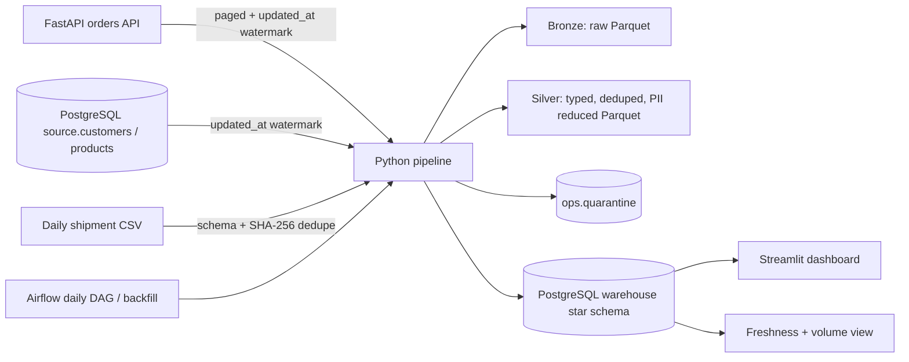
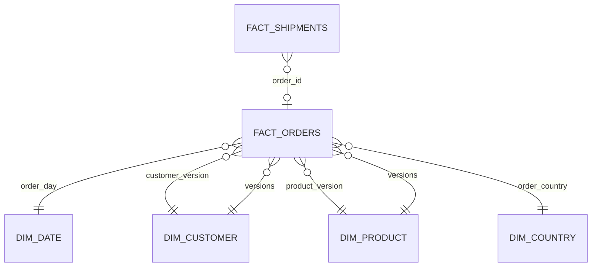

# End-to-End Commerce Data Pipeline

A local, production-style capstone for a fictional e-commerce business. It ingests paginated orders from FastAPI, customer and product snapshots from PostgreSQL, and daily shipment CSV drops. The pipeline writes raw and validated Parquet, quarantines invalid data, builds a dimensional warehouse, and reports metrics in Streamlit.

## Architecture





## Start the stack

Requirements: Docker Desktop with Compose v2. The first startup builds the image and initializes PostgreSQL and Airflow.

```powershell
Copy-Item .env.example .env
# Replace placeholder passwords in .env with unique local values.
docker compose up --build -d
```

Open Airflow at <http://localhost:8080> (username `admin`; password is `AIRFLOW_ADMIN_PASSWORD` from `.env`) and Streamlit at <http://localhost:8501>. Change `AIRFLOW_PORT` or `POSTGRES_PORT` in `.env` if those local ports are already in use. The API health endpoint is <http://localhost:8000/health>. Trigger `commerce_daily_pipeline` for a logical date. The schedule runs daily at 02:15 UTC. Airflow retries failed tasks three times, enforces a 30-minute timeout, and writes structured failure alerts to task logs for log forwarding.

The seeded source rows are effective from 2025-01-01. For a first run, use `2025-03-01`; this day also has a sample shipment drop.

## Backfills and file drops

Use Airflow's DAG trigger form to set a logical date, or run a range from the scheduler container:

```powershell
docker compose exec airflow-scheduler airflow dags backfill commerce_daily_pipeline --start-date 2025-03-01 --end-date 2025-03-07
```

Backfills extract the full requested date slice even when the API watermark is newer. Normal forward daily runs pass the saved `orders_api` high-water timestamp to the API. Reprocessing a date upserts facts by business key and preserves dimension versions when attributes are unchanged.

Place daily drops at `data/file_drops/shipments_YYYY-MM-DD.csv`. The expected columns are `shipment_id,order_id,shipped_at,carrier,status`; file size is capped at 10 MiB. SHA-256 checksums prevent the same file content from being ingested twice. The March 1 sample is valid; the March 3 sample includes one invalid status to demonstrate quarantine. To replay a changed file, supply a new content checksum; malformed records go to `ops.quarantine`.

## Data model and quality

`warehouse.fact_orders` has one row per source order, including cancelled orders. Dashboard order counts and revenue both filter to `completed` so cancelled orders do not inflate sales. Dimensions are `dim_date`, `dim_customer`, `dim_product`, and `dim_country`. Customer and product dimensions use Type 2 versioning (`valid_from`, `valid_to`, `is_current`). Email is SHA-256 hashed and names are pseudonymized before silver and gold; source PostgreSQL retains operational PII.

Validation enforces required fields, primitive types, key uniqueness, nonnegative bounded monetary values, quantity ranges, ISO-like timestamp shape, country codes, allowed statuses, and entity-specific schema rules (more than 15 field checks in total). Invalid rows are excluded from silver and gold and recorded with errors in `ops.quarantine`. `ops.pipeline_runs` records run status, source volumes, duration, and quarantine counts; `warehouse.freshness_volume` exposes these monitoring fields.

For a sample-day reconciliation, compare completed API orders with `warehouse.fact_orders` filtered by `date_key` and `status='completed'`; completed revenue is `quantity * unit_price` in the fact. A successful first March 1 run has five order rows, four completed orders, and two shipment rows.

## Tests and CI

The pytest unit suite covers API pagination fixtures, nulls, invalid types, duplicate business keys, and entity-specific validation/quarantine output. GitHub Actions starts the Compose services, runs one complete Airflow DAG day, reruns that day to check idempotency, validates fact counts, then runs unit tests. CI needs Docker Compose and no external API credentials.

```powershell
docker compose exec airflow-scheduler pytest -q
```

## Security, retention, and operations

`.env` is ignored by Git. Set unique local secrets there; never commit it. The source extractor role has read-only access to `source`; the warehouse loader and Airflow metadata roles are separate. Set a unique Airflow admin password. Use a secrets backend and a production-grade notification target before deployment. All personal identifiers stay in the source system; Parquet and warehouse copies retain only hashes/pseudonyms.

The demo retains local Parquet indefinitely until removed. For a real deployment, define retention by data class and delete bronze files after the approved raw-retention window. Restrict access to the Docker volume and warehouse schemas; quarantine records may contain source fields and should have source-equivalent access controls. To reset this disposable environment, use `docker compose down -v` and then start it again.

## Demo video and submission

Record a 5–8 minute walkthrough showing a scheduled DAG run, a forced task failure and retry alert in logs, a bad row in quarantine, a date-range backfill, and the dashboard. For a failure demonstration, stop `mock-api`, trigger a logical date, confirm Airflow retries and logs `PIPELINE_ALERT`, then restart the service. For quarantine, trigger March 3 and inspect `ops.quarantine`; for a backfill, run the documented March 1–3 command. Push this project to a public GitHub repository and submit the repository and video links in the milestone form.
